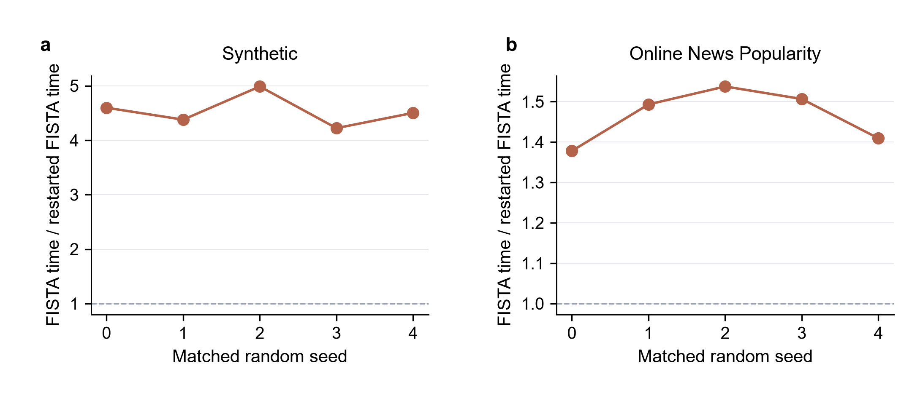

# COMP6704: LASSO Optimization Comparison

[](https://github.com/Yuchen-Wang-CHN/comp6704-lasso-optimization/actions/workflows/tests.yml)
[](LICENSE)

NumPy/SciPy implementations of **ISTA, FISTA, adaptive-restart FISTA, and
ADMM**, compared at a shared certified accuracy for sparse linear regression:

$$
\min_w \frac{\|Xw-y\|_2^2}{2n}+\lambda\|w\|_1.
$$

The experiment record contains **710 main-study runs and 40 direct-backend
checks**, spanning five seeds, synthetic problems, and the UCI Online News
Popularity dataset. All 750 endpoints meet the stopping criteria. A separate
quick record contains 62 runs. The accompanying [research report](report/manuscript/main.pdf)
contains exactly ten pages including references.

## Main results

| Baseline backend | Fastest method | Synthetic mean total time | News mean total time |
|---|---|---:|---:|
| Cached Gram | Restarted FISTA | 8.41 ms | 5.94 ms |
| Direct matrix | ADMM | 19.28 ms | 28.34 ms |

Times include common construction, method setup, iterations, and stopping
diagnostics. Paired FISTA/restarted-FISTA total-runtime ratios average
4.54 on synthetic data and 1.46 on news in the Gram baseline. The comparison
connects solver selection to the linear-algebra backend and complete time to
certified accuracy.



## Install

Python 3.10 or newer is required. Clone this repository and create an environment:

```bash
git clone https://github.com/Yuchen-Wang-CHN/comp6704-lasso-optimization.git
cd comp6704-lasso-optimization
python -m venv .venv
```

Activate it on Linux/macOS with `source .venv/bin/activate`, or in Windows
PowerShell with `.\.venv\Scripts\Activate.ps1`, then install:

```bash
python -m pip install --upgrade pip
python -m pip install -e ".[dev]"
python -m pytest -q
```

`requirements-lock.txt` records the package versions in the original experiment
environment. Run metadata also records the platform, numerical libraries,
single-thread settings, configurations, and timer definition.

## Reproduce the experiments

Run commands from the repository root. Use a fresh output directory for each run.

```bash
# Four-solver synthetic convergence check; no dataset download
python -m experiments.run --config configs/quick.json --experiments convergence --skip-news --output tmp/smoke

# Full experiment set and direct-backend comparison
python -m experiments.run --config configs/full.json --output results/reproduce-full
python -m experiments.run --config configs/direct.json --experiments convergence --output results/reproduce-direct

# Figures, verified numerical tables, and prediction diagnostics
python -m experiments.plot --results results/reproduce-full --output figures/reproduced
python -m experiments.analyze --results results/reproduce-full --direct results/reproduce-direct --output report/reproduced-tables
python -m experiments.diagnostics --results results/reproduce-full --output report/reproduced-tables
```

The full study includes baseline convergence, separate sample and feature
scaling, seven regularization ratios, noise/correlation/sparsity sweeps, and
three ADMM penalty settings. `--experiments` selects individual experiments;
`--skip-news` selects synthetic data. The complete figure command uses the full
experiment record with both datasets.

## Algorithms and evaluation

- Every method starts from zero and solves the same objective and penalty within
  a case. ISTA and FISTA use a fixed spectral step size.
- Adaptive restart resets momentum when
  `(extrapolated - new).T @ (new - old) > 0`, retaining the accepted proximal point.
- ADMM uses a cached Cholesky factorization and a fixed penalty; its reported
  coefficients are the sparse `z` iterate.
- Stopping requires a feasible primal-dual gap divided by
  `max(1, abs(objective))` of at most `1e-6`. ADMM also satisfies primal and dual
  residual thresholds. Certificates are checked every five iterations and
  recalculated from the original training matrix at the endpoint.
- A separately certified scikit-learn coordinate-descent reference checks the
  solutions with matching objective normalization.
- Five seeds determine 70/15/15 train/validation/test splits. All centering and
  scaling statistics come from training. Shared validation-based regularization
  selection precedes test evaluation on the original training-only models.
- Numerical kernels use one thread, are warmed before timing, and run in a
  deterministically shuffled method order. Seed-level SD summarizes data/split
  variability.

Synthetic problems use Gaussian AR(1) features, sparse known coefficients, and
Gaussian noise. The news experiment retains all 39,644 observations and 58
predictive attributes and uses `log1p(shares)`. Dataset attribution and licensing
are documented in [third-party notices](THIRD_PARTY_NOTICES.md) and
`data/raw/manifest.json`.

## Results and source records

| Location | Contents |
|---|---|
| `src/lassoopt/` | Objective, certificates, solvers, preprocessing, data loading |
| `experiments/` | Run, analyze, plot, and diagnostic commands |
| `configs/` | Quick, full, and direct-backend settings |
| `tests/` | 36 numerical and preprocessing tests |
| `results/full/`, `results/direct/` | Run-level tables, histories, coefficients, splits, metadata |
| `results/quick/` | Separate quick experiment record |
| `figures/` | Seven PDF/SVG/PNG figures with source CSVs and QA outputs |
| `report/tables/` | Generated tables and verified numerical findings |
| `report/manuscript/` | Ten-page PDF, editable LaTeX, figures, and tables |

The raw UCI archive and CSV are downloaded automatically on first use. The
provenance manifest records their hashes and preprocessing. Published BLAS
metadata retains library filenames and versions.

## Rebuild the report

Install a LaTeX distribution and retrieve the official report style:

```bash
python tools/fetch_report_style.py
cd report/manuscript
pdflatex -interaction=nonstopmode -halt-on-error main.tex
pdflatex -interaction=nonstopmode -halt-on-error main.tex
```

From the repository root, `python tools/verify_report.py` renders all pages and
checks the exact ten-page requirement, text bounds, reference markers, and font
sizes. This check requires Poppler's `pdftoppm` on `PATH` and the development
dependencies. The manuscript's numerical descriptions correspond to the stored
record; update them when replacing the experiment results.

## References

- Tibshirani (1996), [Regression Shrinkage and Selection via the Lasso](https://doi.org/10.1111/j.2517-6161.1996.tb02080.x).
- Beck and Teboulle (2009), [A Fast Iterative Shrinkage-Thresholding Algorithm for Linear Inverse Problems](https://doi.org/10.1137/080716542).
- Boyd et al. (2011), [Distributed Optimization and Statistical Learning via the Alternating Direction Method of Multipliers](https://web.stanford.edu/~boyd/papers/admm_distr_stats.html).
- O'Donoghue and Candes (2015), [Adaptive Restart for Accelerated Gradient Schemes](https://arxiv.org/abs/1204.3982).
- Moursi et al. (2023), [Accelerated Gradient Descent: A Guaranteed Bound for a Heuristic Restart Strategy](https://arxiv.org/abs/2310.07674).

## License

Project-specific code and documentation use the [MIT License](LICENSE).
The four vendored figure-QA utilities retain Apache-2.0 licensing. Dataset and
report-style sources are listed in [THIRD_PARTY_NOTICES.md](THIRD_PARTY_NOTICES.md).
